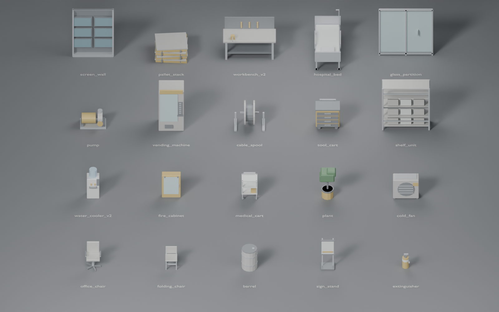

# 10 · 第二批 Blender 道具（20 件）

在 `tools/blender/gen_props.py` 上**增量**追加 20 个程序化道具，原有 21 个保持不变。产出仍在
`game/Assets/_Project/Art/Props/`：`P_<id>.fbx` + `P_<id>.json`，`prop_manifest.json` 现在包含 41 项。

总览图：`screenshots/props-showcase-2.png`（1600×1000，Blender Cycles 直接渲染，20 件全部带 id 标签）。



## 1. 新增道具表

尺寸为 FBX 实际包围盒（宽 W × 深 D × 高 H，米）；`tris` 为三角面数，`预算` 按 04-3D 资产规范
（大件 ≤1500 / 中件 ≤900 / 小件 ≤300）。pivot 均在底面中心，正面朝 +Z（Unity 空间）。

| id | 中文名 | W × D × H | tris | 预算 | 用途 | 建议摆放 |
|----|--------|-----------|------|------|------|----------|
| `office_chair` | 办公椅 | 0.59 × 0.56 × 1.02 | 292 | 300 | 办公区座椅，带滚轮底座/扶手 | 办公桌前后、会议桌旁、开放办公区 |
| `folding_chair` | 折叠椅 | 0.44 × 0.43 × 0.82 | 160 | 300 | 替换 74 件灰盒折叠椅 | 茶水间、临时会议、仓库角落 |
| `cold_fan` | 冷风机 | 0.96 × 0.49 × 0.92 | 224 | 900 | 替换 49 件灰盒冷风机 | 冷库门口、机房过道、车间墙边 |
| `pump` | 泵组 | 0.96 × 0.68 × 0.69 | 284 | 900 | 独立泵体（区别于储罐 tank） | 管道间、设备层、冷机房 |
| `screen_wall` | 屏幕墙 | 1.54 × 0.26 × 2.11 | 224 | 1500 | 2×2 拼接大屏 + 落地支架 | 控制室主墙、安防监控室、大厅 |
| `vending_machine` | 售货机 | 0.94 × 0.77 × 1.94 | 356 | 900 | 饮料/零食售货机 | 休息区、走廊端头、食堂入口 |
| `water_cooler_v2` | 直饮水机 | 0.46 × 0.50 × 1.24 | 176 | 300 | 饮水机升级版（桶装水 + 双出水口） | 茶水间、办公区走道 |
| `shelf_unit` | 仓储货架 | 1.78 × 0.58 × 1.97 | 864 | 1500 | 普通仓储货架（三层横梁 + 层板），区别于 cold_shelf | 仓库、车间备件区、后勤库房 |
| `pallet_stack` | 托盘堆 | 1.22 × 1.04 × 0.67 | 216 | 1500 | 木托盘 + 货物堆（可与装卸托盘 pallet 搭配） | 仓库地面、装卸区、货架旁 |
| `barrel` | 油桶 | 0.60 × 0.60 × 0.89 | 204 | 300 | 200L 标准桶，带桶箍/桶盖 | 车间、油料间、管道间角落 |
| `cable_spool` | 电缆盘 | 1.14 × 0.92 × 1.08 | 332 | 900 | 木轴电缆盘（含支架与线缆层） | 车间、机房弱电间、施工区 |
| `sign_stand` | 立式指示牌 | 0.50 × 0.40 × 1.33 | 148 | 300 | 配重底座 + 立柱 + **空白牌面**（留白等 signage 贴图） | 走廊岔口、电梯厅、施工警示位 |
| `plant` | 绿植 | 0.61 × 0.51 × 1.31 | 336 | 900 | 花盆 + 主干 + 四团灌木（绿色叶片材质） | 大厅、前台、休息区、办公区角落 |
| `fire_cabinet` | 消防柜 | 0.70 × 0.30 × 1.06 | 116 | 300 | 红色消防柜，玻璃门 + 隔板 + 把手 | 走廊墙边（贴墙）、楼梯口 |
| `extinguisher` | 灭火器 | 0.28 × 0.26 × 0.62 | 196 | 300 | 手提式灭火器（罐体/色带/阀头/喷管） | 消防柜旁、配电间门口、车间柱边 |
| `hospital_bed` | 病床 | 0.98 × 2.02 × 1.52 | 396 | 1500 | 带护栏/床头的病床，含输液架（区别于 bed 床铺） | 医疗层病房、隔离间、医务室 |
| `medical_cart` | 医疗推车 | 0.58 × 0.46 × 0.96 | 244 | 300 | 三层医疗推车 + 抽屉 + 脚轮 | 病房床头、护士站、处置室 |
| `tool_cart` | 工具车 | 0.92 × 0.62 × 1.02 | 332 | 900 | 五屉工具车 + 推把 + 脚轮 | 车间工位旁、维修间、设备层 |
| `workbench_v2` | 加固工作台 | 1.96 × 0.93 × 1.44 | 344 | 1500 | 钢木工作台 + 洞洞板 + 台下抽屉（区别于 workbench） | 车间、维修间、装配工位 |
| `glass_partition` | 玻璃隔断 | 2.02 × 0.22 × 2.17 | 216 | 1500 | 薄玻璃板 + 金属框 + 立柱，预留透明材质 | 办公区分隔、机房观察窗、医疗隔断 |

## 2. 面数达标情况

全部 20 件均低于预算，且余量普遍在 2–5 倍：

| 档位 | 预算 | 新道具 tris | 结论 |
|------|------|-------------|------|
| 大件（large） | ≤1500 | screen_wall 224、shelf_unit 864、pallet_stack 216、hospital_bed 396、workbench_v2 344、glass_partition 216 | 全部达标，最高 shelf_unit 864（57% 预算） |
| 中件（medium） | ≤900 | cold_fan 224、pump 284、vending_machine 356、cable_spool 332、plant 336、tool_cart 332 | 全部达标，最高 vending_machine 356（40% 预算） |
| 小件（small） | ≤300 | office_chair 292、folding_chair 160、water_cooler_v2 176、barrel 204、sign_stand 148、fire_cabinet 116、extinguisher 196、medical_cart 244 | 全部达标，office_chair 292 最接近上限（97%），其余余量充足 |

生成时脚本会逐件打印 `[PROP] <id> tris=<n> OK <W> x <D> x <H> m -> <fbx>`；若新道具（非历史豁免项）
超预算，`main()` 会打印 `BUDGET FAIL` 并以 **exit code 3** 结束。历史 21 件里 `archive_shelf`(3024)、
`cabinet_group`(1956)、`sofa`(1004)、`trash_bin`(356)、`water_cooler`(324) 已超标，列入
`LEGACY_OVER_BUDGET` 只告警、不阻塞（按要求未改动它们）。

旧 21 个 FBX 在追加前后做了 MD5 对比，全部未变化；仅 `prop_manifest.json` 从 21 项扩到 41 项。

### pivot / 坐标自检

生成后又用 Blender 把 20 个新 FBX 重新导入、按世界坐标复算包围盒：

- **20/20** 件 `zmin = 0.000`（≤0.003 容差），包围盒中心 `x = y = 0.000` —— pivot 在底面中心；
- 复算三角面数与 manifest 完全一致（见上表）；
- 宽/深/高与 `P_<id>.json` 一致（±1cm 内）。

这一步发现并修掉了原 `finish()` 的老 bug（细节见下节）。修复前旧道具的 pivot 是偏的，例如：
`desk` zmin=-0.725 / zmax=0.025、`bed` -0.220 / 0.480、`locker` -0.900 / 0.860、
`crate_stack` zmin=-0.220 且 xc=+0.320。因为 `PropPipeline` 会用 JSON 高度生成
`BoxCollider(center.y = height/2)`，pivot 偏了会让碰撞体和模型错位（模型陷入地板），建议单独开一轮
修复：确认后重跑全量生成器（新 `finish()` 已修好），Unity 里重新 Import 即可，不需要改 LevelGen。

## 3. 生成器改动（增量）

- `box()` 增加 `segments`（倒角段数）、`cyl()` 增加 `segments`，供小件把面数压到 300 以内；新增 `rot(ob, axis, deg)` 做旋转 apply。
- 新增材质：`M_PropGlass`、`M_PropBottle`、`M_PropLinen`、`M_PropLeaf`（绿植叶片）。
- `TRI_BUDGET` / `LEGACY_OVER_BUDGET` + `build_one` 的 tris 自检与 `main()` 的 exit 3 拦截。
- `merge_manifest()`：`--only` 分批生成时读回旧清单再合并，不再把其他道具条目冲掉（原来的 `main()` 每次只写本批 metas）。
- 修了 `finish()` 的 pivot bug：旧写法直接减世界坐标包围盒、但没把活动物体的 `location` 归零，导致 mesh
  底面落在 `-location.z` 而不是 0（`desk` 实测 zmin=-0.725、`bed` -0.22、`locker` -0.90）。现在先
  `transform_apply(location/rotation/scale)` 再平移，新道具重新导出后 zmin 全部 = 0.000。**注意**：
  旧 21 个 FBX 没有重新生成（保持逐字节不变），所以它们仍是旧 pivot；要修需要在评审后整目录重跑一次生成器。
  注意：全量运行会连带重导出旧 21 个（pivot 修正、尺寸/面数不变），只想补新道具请继续用 `--only`。
- 新增 `--render <png>`：不生成 FBX，直接在 Blender 里摆位渲染联系表（5 列 × 4 排、正交相机约 38° 俯角、三点面光 + 太阳光、灰底、地面 id 标签、Cycles CPU 24 samples + 降噪、1600×1000）。

运行方式：

```powershell
# 全量 / 单批
& "F:\Tools\blender\blender-4.2.9-windows-x64\blender.exe" -b -P "tools\blender\gen_props.py" -- --out "game\Assets\_Project\Art\Props"
& "...\blender.exe" -b -P "tools\blender\gen_props.py" -- --out "...\Art\Props" --only office_chair,plant

# 联系表（只渲下面 20 个新道具）
& "...\blender.exe" -b -P "tools\blender\gen_props.py" -- --out "...\Art\Props" --render "docs\3d-rebuild\screenshots\props-showcase-2.png"
```

## 4. 与 PropCatalog / 生成器名字的对应建议

`PropPipeline.FillCatalog()` 先写真实道具、再写 `Aliases`，`PropCatalog.TryGet` 按顺序返回第一个同名项，
所以真实道具同名时**会**生效，但别留重复条目。当前 LevelGen / Aliases 里与新道具同名或该改指向的：

| 生成器里的名字 | 现在指向 | 建议 |
|----------------|----------|------|
| `冷风机` | 无（灰盒） | **直接命中**新道具 `cold_fan`（DISPLAY_NAME 同为“冷风机”），无需 alias |
| `折叠椅` | 无（灰盒，74 件） | **直接命中** `folding_chair`（同为“折叠椅”） |
| `屏幕墙` | `control_console`（Alias） | 从 `Aliases` **删除**，改由真实道具 `screen_wall` 提供（否则目录里有两条“屏幕墙”） |
| `泵组` | `tank`（Alias） | 从 `Aliases` **删除**，改由 `pump` 提供 |
| `货架` | `cold_shelf`（冷库货架） | 建议改指 `shelf_unit`（普通仓储货架）；冷库内仍用 `cold_shelf` 的真实名“冷库货架” |
| `隔离床` | `bed`（床铺） | 建议改指 `hospital_bed`（带护栏/输液架）；医务室普通床仍用 `bed` |
| `工具柜` | `med_cabinet` | 可改指 `tool_cart`（若语义偏“移动工具车”）；固定工具柜仍用 `med_cabinet` |
| `饮水机` | `water_cooler` | 保留；新 `water_cooler_v2` 名字是“直饮水机”，可作升级替换 |
| `工作台` | `workbench` | 保留；`workbench_v2` 名字是“加固工作台”，可在车间层单独加 PropSpec |

另外 LevelGen 目前**还没有**生成这些名字，需要时可直接加 `PropSpec`（尺寸参考上表）：
办公椅 / 售货机 / 直饮水机 / 仓储货架 / 托盘堆 / 油桶 / 电缆盘 / 立式指示牌 / 绿植 / 消防柜 /
灭火器 / 病床 / 医疗推车 / 工具车 / 加固工作台 / 玻璃隔断。

## 5. 已知不足

1. **折叠椅高度偏大**：模型 0.82m，`FacilityGrammar` 里的 `PropSpec` 是 0.5m。生成器按占地摆放不会缩放，
   但 `PropPipeline` 会用 JSON 的 Height 生成碰撞盒（0.82m），比灰盒高，可能影响“可翻越”判定；
   若要严格对齐，请把 PropSpec 高度改为 0.82 或把椅背压低。
2. **泵组深度 0.68m** 比 PropSpec 的 0.6m 多 8cm（出口阀伸出）；贴墙摆放时可能轻微嵌墙，可缩短出口管。
3. **病床 1.52m 高**含输液架；若摆放层高紧张或需要低矮碰撞盒，建议在 Unity prefab 上单独调 BoxCollider 高度。
4. **玻璃隔断需要透明材质**：`PropPipeline` 会把 prefab 里所有 Renderer 换成同一个 slot 材质，
   `glass_partition` / `fire_cabinet` / `vending_machine` 的玻璃部分在 Unity 里会变成不透明。
   后续要么给玻璃单独 slot（扩 `MaterialArtLibrary`），要么在 `BuildPrefab` 里按材质名保留。
5. **material_slots 大多匹配不到** `MaterialArtLibrary` 的 10 个 slot，会按 `size_class` 回退到
   PropLarge/Medium/Small 纯色材质；Blender 里的玻璃/瓶身/亚麻/叶片颜色只用于总览图，不进 Unity。
6. **没有 LOD1**：04 规范要求各带一级 LOD，这批只做了 LOD0；tris 余量足够，但长距离切换仍需补。
7. **UV 只是程序化基元自带的盒式/柱式 UV**，没有精细展开；纯色/简单贴图够用，贴 signage 前需要在
   `sign_stand` 牌面上单独排 UV（牌面是独立四边形，容易改）。
8. 总览图标签是 Blender 文本对象 + ASCII id，没有中文；若要中文标签需在 Blender 里加载中文字体，
   本机 headless 未配字体，故保持 id。
9. 补充：`archive_shelf` / `cabinet_group` / `sofa` / `trash_bin` / `water_cooler` 仍超面数预算，本次按要求未改；
   如需达标可把它们的 bevel segments 降一档。
