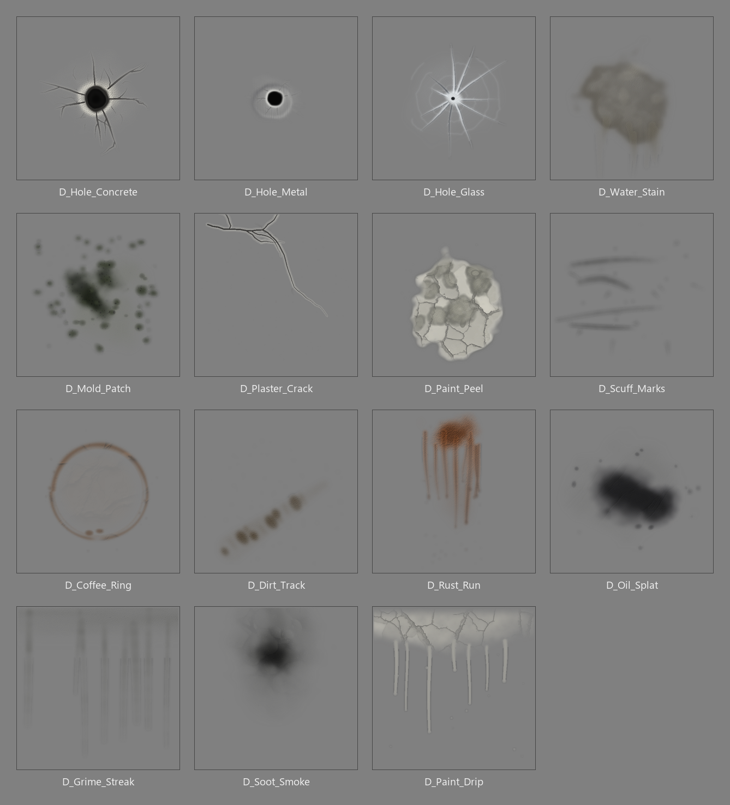

# 贴花（Decal）资源

本目录由 `tools/art/gen_decals.py` 生成，**未改动仓库里任何已有文件**。

- 格式：`512 × 512 RGBA`，透明底；`Alpha` = 贴花形状与不透明度，`RGB` = 污渍本体色。
- 用法：一张 quad + `Alpha Blend`（或 Unity Decal Projector）贴在墙面/地面/玻璃上；alpha 是直通（straight）的，不要按预乘处理。
- 每张最外 2px 的 `alpha` 强制为 0，2~8px 之间渐隐，因此可以直接当 quad 用，不会出现硬矩形边。
- 内部 alpha 由中心向外衰减，峰值≠1（除弹孔孔芯），避免「贴纸感」；需要更浓时在材质里叠两张不同旋转。



## 生成命令

```powershell
# 全量重出（ComfyUI 底图有缓存时不需要 GPU，直接复用底图）
C:\Users\17613\.dsh\dsh-runtimes\dsh-primary-runtime\dependencies\python\python.exe F:\Workspace\ESCAPE FROM WORK\tools\art\gen_decals.py

# 只重出某几张
... gen_decals.py --only D_Oil_Splat D_Rust_Run

# 重出 AI 材质底图（需要 ComfyUI 在 127.0.0.1:8188）
... gen_decals.py --regen-ai

# 没有 ComfyUI 时用占位噪声，只调程序化形状
... gen_decals.py --no-ai
```

AI 底图缓存：`F:\ComfyUI\output\decals\base_<key>.png`（SDXL base 1.0，1024²，dpmpp_2m + karras，24 steps，cfg 6.5，固定 seed）。
脚本用 `zlib.crc32(名字)` 派生每张图的种子，增删贴花不会打乱其它图的随机序列，同参数重跑像素字节一致（`--no-ai` 也一样，占位噪声也是固定种子）。

## 一览表

| 文件 | 用途 | 建议世界尺寸 | 贴附表面 | 可平铺 | Alpha 覆盖率 |
|------|------|-------------|---------|-------|-------------|
| `D_Hole_Concrete.png` | 混凝土/石膏墙弹孔 | 0.30 m（孔芯约 7 cm） | ConcreteWall / PaintedWall / ConcreteFloor / CeilingTile 等灰质墙面、柱子 | 否（单次贴花，不可平铺） | 14.8% |
| `D_Hole_Metal.png` | 金属板弹孔 | 0.22 m（孔芯约 4.5 cm） | MetalDoor / DarkMetal / DiamondPlate / ServerPanel 等涂装钢板 | 否 | 6.2% |
| `D_Hole_Glass.png` | 玻璃弹孔（蛛网裂纹） | 0.40 m（核心约 4 cm） | GlassPanel 隔断、窗、玻璃门（叠在不透明磨砂玻璃上） | 否 | 15.6% |
| `D_Water_Stain.png` | 渗水痕 | 1.1 m | ConcreteWall / PaintedWall / CeilingTile（天花板渗漏） | 否 | 26.3% |
| `D_Mold_Patch.png` | 霉斑 | 1.0 m | ConcreteWall / PaintedWall、卫生间/机房墙角、CeilingTile | 否 | 26.4% |
| `D_Plaster_Crack.png` | 石膏裂纹 | 1.6 m | PaintedWall / ConcreteWall / CeilingTile（腻子层开裂） | 否 | 4.6% |
| `D_Paint_Peel.png` | 漆皮起壳 | 1.0 m | PaintedWall / IndustrialPaint / MetalDoor（涂装面） | 否 | 29.1% |
| `D_Scuff_Marks.png` | 鞋底擦痕/拖拽痕 | 0.9 m | TileFloor / EpoxyFloor / ConcreteFloor / DiamondPlate | 否 | 8.4% |
| `D_Coffee_Ring.png` | 咖啡杯圈渍 | 0.12 m（杯底约 7 cm） | EpoxyFloor / WoodPanel / VenueCarpet 桌面、会议桌、茶水间台面 | 否 | 19.6% |
| `D_Dirt_Track.png` | 泥脚印/拖痕 | 1.2 m | ConcreteFloor / EpoxyFloor / TileFloor、装卸区/楼梯间 | 否 | 8.1% |
| `D_Rust_Run.png` | 锈水垂痕 | 0.9 m（竖向） | IndustrialPaint / ColdMetal / MetalDoor / DiamondPlate，螺栓与焊缝下方 | 否 | 17.9% |
| `D_Oil_Splat.png` | 油渍 | 1.0 m | EpoxyFloor / DiamondPlate / ConcreteFloor / ServerPanel 机房地面 | 否 | 26.4% |
| `D_Grime_Streak.png` | 竖向污渍 | 1.4 m（竖向） | ConcreteWall / IndustrialPaint / CleanPanel / ServerPanel 墙与设备侧面 | 否（如需无缝可用 2 张错位叠贴） | 33.6% |
| `D_Soot_Smoke.png` | 烟熏/烧灼痕 | 1.4 m | ConcreteWall / PaintedWall / CeilingTile，战斗后墙角、配电箱、起火点上方 | 否 | 25.3% |
| `D_Paint_Drip.png` | 油漆流挂 | 0.9 m | IndustrialPaint / MetalDoor / ConcreteWall（施工未干的流挂） | 否 | 28.2% |

覆盖率 = `alpha > 0.06` 的像素占比（视觉比重，不是全透明面积），用来判断贴花在场景里大概占多大视觉比重，以及四边是否真的留空。

## 逐张说明：AI 生成 vs 程序化生成

### `D_Hole_Concrete.png` — 混凝土/石膏墙弹孔

- **建议世界尺寸**：0.30 m（孔芯约 7 cm）；贴附表面：ConcreteWall / PaintedWall / ConcreteFloor / CeilingTile 等灰质墙面、柱子；可平铺：否（单次贴花，不可平铺）。
- **AI 生成**：concrete 底图：水泥灰浆颗粒、气孔、粉尘斑驳（重染到 0.70 灰，detail 0.55）。
- **程序化生成**：三层：粉尘光晕（域扭曲椭圆 + 径向衰减）→ 崩边亮环（高频噪声咬边）→ 孔唇亮/暗双环 → 近黑孔芯（带一圈内壁反光）；9 条放射主裂纹（分叉随机游走，带粉化晕 + 唇口高光 + 暗芯）、16 条发丝裂纹、碎屑散点。
- **已知不足**：裂纹尺度按 512px 手调，放到 0.6 m 以上会看出笔刷尺度；没有法线/视差，斜视时孔洞不「凹」。
- 实测：alpha 覆盖率 14.8%，峰值 1.00，四边 2px 内 alpha = 0。

### `D_Hole_Metal.png` — 金属板弹孔

- **建议世界尺寸**：0.22 m（孔芯约 4.5 cm）；贴附表面：MetalDoor / DarkMetal / DiamondPlate / ServerPanel 等涂装钢板；可平铺：否。
- **AI 生成**：metal 底图：细漆面颗粒与微弱磨损（重染 0.68 灰，detail 0.50）。
- **程序化生成**：漆面崩落区（不规则灰白）→ 塑性凹坑（单向明暗：亮边/暗边按光照方向加权）→ 近黑孔芯 + 亮金属翻边（rim 高斯 + 角度加权高光弧）→ 7 条放射细裂 + 12 条弹道擦痕（方向性笔刷）。
- **已知不足**：翻边高光与凹坑明暗都假设主光在左上，光源方向差太多时会轻微违和。
- 实测：alpha 覆盖率 6.2%，峰值 1.00，四边 2px 内 alpha = 0。

### `D_Hole_Glass.png` — 玻璃弹孔（蛛网裂纹）

- **建议世界尺寸**：0.40 m（核心约 4 cm）；贴附表面：GlassPanel 隔断、窗、玻璃门（叠在不透明磨砂玻璃上）；可平铺：否。
- **AI 生成**：glass 底图：磨砂玻璃极细蚀刻颗粒（重染 0.80/0.82/0.84，detail 0.30）。
- **程序化生成**：9 条近直线径向裂纹（wander 0.03，12 段，每条配一条偏移暗线做蚀刻层次 + 短支裂纹）、4 圈同心蛛网弧（半径抖动 ±5px、随机断口）、发白粉碎核心、中心穿透小孔、玻璃屑亮点。
- **已知不足**：裂纹靠 alpha 亮线模拟，在纯暗背景前不如真实折射亮；玻璃孔是画在表面上的，不是真通孔。
- 实测：alpha 覆盖率 15.6%，峰值 0.97，四边 2px 内 alpha = 0。

### `D_Water_Stain.png` — 渗水痕

- **建议世界尺寸**：1.1 m；贴附表面：ConcreteWall / PaintedWall / CeilingTile（天花板渗漏）；可平铺：否。
- **AI 生成**：water 底图：受潮石膏的矿物潮痕与粉化颗粒（重染 0.42/0.40/0.35，detail 0.50）。
- **程序化生成**：三个团块的并集形状（上大、下窄、右下溢）→ 外侧潮气晕（blur 差集）→ 主体 + 内芯（blur 加深）→ 潮线（4·m·(1−m) 边界环带，双圈）→ 7 条指状拖尾（越往下越细越透明，掩膜法避免串珠）+ 2 条宽拖痕 → 5 处水碱白霜。
- **已知不足**：本体 alpha 峰值只有 ~0.55，必须贴在同色系墙面上；贴到深色金属上会发灰。
- 实测：alpha 覆盖率 26.3%，峰值 0.81，四边 2px 内 alpha = 0。

### `D_Mold_Patch.png` — 霉斑

- **建议世界尺寸**：1.0 m；贴附表面：ConcreteWall / PaintedWall、卫生间/机房墙角、CeilingTile；可平铺：否。
- **AI 生成**：water + mold 底图：孢子团颗粒、粉状边缘（mold 底图只取亮度，detail 0.55）。
- **程序化生成**：6 团并集潮气晕（灰绿、很淡）+ 4 团主霉簇（边缘用 22 cells 高频噪声咬碎成绒毛感）+ 22 团中/小簇（各自域扭曲）+ 240 个簇内孢子 + 90 个远处孢子。
- **已知不足**：深色霉斑在深色底材上对比会掉；建议只贴在中浅灰/米白墙面。
- 实测：alpha 覆盖率 26.4%，峰值 0.97，四边 2px 内 alpha = 0。

### `D_Plaster_Crack.png` — 石膏裂纹

- **建议世界尺寸**：1.6 m；贴附表面：PaintedWall / ConcreteWall / CeilingTile（腻子层开裂）；可平铺：否。
- **AI 生成**：plaster 底图：白垩质腻子的细龟裂与粉化（重染 0.76/0.75/0.71）。
- **程序化生成**：1 条主裂缝（24 段随机游走）+ 4 条支缝，同一路径画三层：粉化起壳带（半径 8→3px，沿程浓度起伏）→ 偏侧高光唇（+2.0/+2.6px 偏移，宽 1.8px）→ 暗色裂缝芯（半径 2.6→0.40px）；30 条二次龟裂 + 碎屑散点。
- **已知不足**：裂纹路径是程序化随机的，同一张不宜在相邻墙面重复使用，否则能看出同一条裂纹；裂缝芯只有 2~3px，贴到 1.6 m 以上会明显偏细。
- 实测：alpha 覆盖率 4.6%，峰值 0.88，四边 2px 内 alpha = 0。

### `D_Paint_Peel.png` — 漆皮起壳

- **建议世界尺寸**：1.0 m；贴附表面：PaintedWall / IndustrialPaint / MetalDoor（涂装面）；可平铺：否。
- **AI 生成**：paint + plaster 底图：干裂漆膜与露出的腻子底材。
- **程序化生成**：残漆块（大尺度域扭曲 + 40 cells 高频咬边，边缘不光滑）→ 外侧软阴影 → 残漆本体（0.77 灰，压住亮度）→ 15 处露底斑块（内缘暗影 + 中心微亮）→ 58 条漆面 crazing 细裂 → 翘边高光 + 碎片散点。
- **已知不足**：露底斑块假设底材是灰绿腻子；贴到已经露混凝土的位置会重复「露底」。
- 实测：alpha 覆盖率 29.1%，峰值 1.00，四边 2px 内 alpha = 0。

### `D_Scuff_Marks.png` — 鞋底擦痕/拖拽痕

- **建议世界尺寸**：0.9 m；贴附表面：TileFloor / EpoxyFloor / ConcreteFloor / DiamondPlate；可平铺：否。
- **AI 生成**：scuff 底图：橡胶磨耗的干粉状条痕（重染 0.205 深灰，detail 0.50）。
- **程序化生成**：4 条近水平主擦痕（弓形 + 独立粗细，沿程 alpha 用 sin 包络淡出）+ 1 条很淡的长拖拽痕 + 14 条短促擦点 + 各向异性 fBm（cells_x=3/cells_y=28）× 42 cells 高频调制 + 橡胶蹭点 + 干粉尘。
- **已知不足**：整体很淡（峰值 alpha 只有 0.38），是「近看才见」的细节层；需要更脏就叠两张不同旋转。
- 实测：alpha 覆盖率 8.4%，峰值 0.38，四边 2px 内 alpha = 0。

### `D_Coffee_Ring.png` — 咖啡杯圈渍

- **建议世界尺寸**：0.12 m（杯底约 7 cm）；贴附表面：EpoxyFloor / WoodPanel / VenueCarpet 桌面、会议桌、茶水间台面；可平铺：否。
- **AI 生成**：stain 底图：干涸液膜的细沉积纹。
- **程序化生成**：角向一维噪声驱动：环半径抖动 ±4%、厚度 2.6~11px、浓度沿环断口；内外双环 + 杯底薄膜 + 14 个环上积垢点 + 2 处侧漏小滩 + 16 个外溅点。
- **已知不足**：环半径固定（只有抖动），同一桌面上重复贴会看出同一个缺口位置。
- 实测：alpha 覆盖率 19.6%，峰值 0.55，四边 2px 内 alpha = 0。

### `D_Dirt_Track.png` — 泥脚印/拖痕

- **建议世界尺寸**：1.2 m；贴附表面：ConcreteFloor / EpoxyFloor / TileFloor、装卸区/楼梯间；可平铺：否。
- **AI 生成**：dirt 底图：干泥与砂砾颗粒（重染 0.325/0.275/0.205）。
- **程序化生成**：3 个鞋印（前掌椭圆 + 4 个脚趾 + 窄足弓 + 后跟，鞋底凹槽用 alpha 咬出；各自独立旋转，边缘被高频噪声咬碎）+ 3 条斜向拖拽主痕 + 泥点 + 干湿不均噪声调制。
- **已知不足**：脚印是简化轮廓，不是解剖学正确的鞋底；贴近镜头仍能看出椭圆拼出来的趾/跟。
- 实测：alpha 覆盖率 8.1%，峰值 0.81，四边 2px 内 alpha = 0。

### `D_Rust_Run.png` — 锈水垂痕

- **建议世界尺寸**：0.9 m（竖向）；贴附表面：IndustrialPaint / ColdMetal / MetalDoor / DiamondPlate，螺栓与焊缝下方；可平铺：否。
- **AI 生成**：rust 底图：氧化铁鳞片与粉状锈（重染 0.505/0.293/0.163）。
- **程序化生成**：顶部锈源团块 → 8 条重力垂痕（每段独立随机浓淡 + 深色芯 + 横向漂移 + 末端积垢珠）→ 下方漫流（各向异性拉丝）→ 48 个氧化铁颗粒。
- **已知不足**：假设锈源在贴花上缘正中；要挂在螺栓正下方时需要按世界位置对齐（pivot 建议 0.5, 0.9）。
- 实测：alpha 覆盖率 17.9%，峰值 0.97，四边 2px 内 alpha = 0。

### `D_Oil_Splat.png` — 油渍

- **建议世界尺寸**：1.0 m；贴附表面：EpoxyFloor / DiamondPlate / ConcreteFloor / ServerPanel 机房地面；可平铺：否。
- **AI 生成**：oil 底图：油泥与薄膜的暗色颗粒。
- **程序化生成**：三个瓣的并集形状（有流淌方向）→ 外渗晕 → 主体 + 浓黑芯（blur 差集加深）→ 边缘油膜虹彩（边界环带，低饱和冷色）→ 14 颗沿径向拉长的卫星油滴。
- **已知不足**：虹彩只是固定的低饱和冷色，不是真的薄膜干涉；如果以后有 specular/clearcoat 通道，应把油渍做成 smoothness 更高的材质。
- 实测：alpha 覆盖率 26.4%，峰值 0.93，四边 2px 内 alpha = 0。

### `D_Grime_Streak.png` — 竖向污渍

- **建议世界尺寸**：1.4 m（竖向）；贴附表面：ConcreteWall / IndustrialPaint / CleanPanel / ServerPanel 墙与设备侧面；可平铺：否（如需无缝可用 2 张错位叠贴）。
- **AI 生成**：concrete 底图：灰尘与细颗粒（重染 0.365 灰，detail 0.45）。
- **程序化生成**：顶部灰污带（高斯，模拟从上方流下的起点）→ 8 条竖向污痕（每段独立随机浓淡、宽度渐细、横向漂移）→ 各向异性 fBm（cells_x=2/cells_y=34）断续 + 24 cells 高频毛边 → 底部按 Y 淡出。
- **已知不足**：为保证四边 alpha=0（不出现硬矩形）放弃了平铺；大面积墙面请错位叠 2~3 张。
- 实测：alpha 覆盖率 33.6%，峰值 0.48，四边 2px 内 alpha = 0。

### `D_Soot_Smoke.png` — 烟熏/烧灼痕

- **建议世界尺寸**：1.4 m；贴附表面：ConcreteWall / PaintedWall / CeilingTile，战斗后墙角、配电箱、起火点上方；可平铺：否。
- **AI 生成**：soot 底图：炭黑与灰烬颗粒（重染 0.215 灰，detail 0.55）。
- **程序化生成**：羽状烟场（两套各向异性噪声分别控制轮廓与撕裂）→ 浓黑核心（blur 差集）→ 10 条向上舔舐并收窄的暗丝 → 170 个炭粒 + 60 个灰白灰烬。
- **已知不足**：没有真正的「烧焦碳化」质感（缺法线/自发光）；适合中远景，近景贴脸会偏软。
- 实测：alpha 覆盖率 25.3%，峰值 0.91，四边 2px 内 alpha = 0。

### `D_Paint_Drip.png` — 油漆流挂

- **建议世界尺寸**：0.9 m；贴附表面：IndustrialPaint / MetalDoor / ConcreteWall（施工未干的流挂）；可平铺：否。
- **AI 生成**：paint 底图：漆膜干裂与颗粒（重染 0.795/0.785/0.745，detail 0.40）。
- **程序化生成**：顶部残漆带（域扭曲团块 + 高频咬碎下缘 + 上边距留空）→ 下缘厚度阴影 → 7 条重力流挂（渐细 + 末端积漆珠 + 珠上高光）→ 12 个点状漆滴。
- **已知不足**：漆色偏亮米白，只适合浅色涂装面；深色面上会像白色涂料。
- 实测：alpha 覆盖率 28.2%，峰值 0.70，四边 2px 内 alpha = 0。

## 通用已知不足

1. 全部是 **albedo-only** 贴花：没有法线/粗糙度/自发光通道，孔洞的「凹陷感」靠 albedo 里的暗环与高光弧假装，斜视时说服力有限。
2. 光照方向：`D_Hole_Metal` 的凹坑明暗/翻边高光、`D_Paint_Drip` 的漆带阴影是按「主光在左上」烤的；实际场景主光方向相反时会轻微违和。
3. 弹孔组没有做「穿透」版本：玻璃孔是画在磨砂玻璃表面的，真正的通孔需要建模或额外的 refraction 贴花。
4. alpha 边缘羽化 1.6~5px（@512）：贴到 2m 以上的大表面时边缘会偏软，需要更锐利就换更大的源尺寸重出。
5. 每张都是单次贴花，不可平铺；大面积墙面的竖向污渍请错位叠 2~3 张（`D_Grime_Streak`）。
6. 没有写 `.meta`：交给 Unity 首次导入自动生成（默认 Texture Type 是 Default，需要手动改成 `Default` + `Alpha Is Transparency` + `sRGB`，并关闭 sRGB 之外的压缩或改用 BC7 保持 alpha 质量）。
7. 形状全部由解析距离场笔刷 + 2×2 亚采样画出（软椭圆斑、胶囊笔刷、径向/边界环带），没有 `draw.rectangle` / 整块矩形覆盖，放大到 4× 也看不到直角块；但所有形体都是「画」出来的，极度贴近镜头（<0.15 m）时仍能看出笔刷的数学校准感。
8. 最弱的三张：`D_Dirt_Track` 的鞋印仍是椭圆拼合，凑近看趾/跟分界不够硬；`D_Rust_Run` 的垂痕是宽度渐变胶囊，端头偏「齐」；`D_Paint_Drip` 顶部漆带下缘偏几何，近看像被切过。
